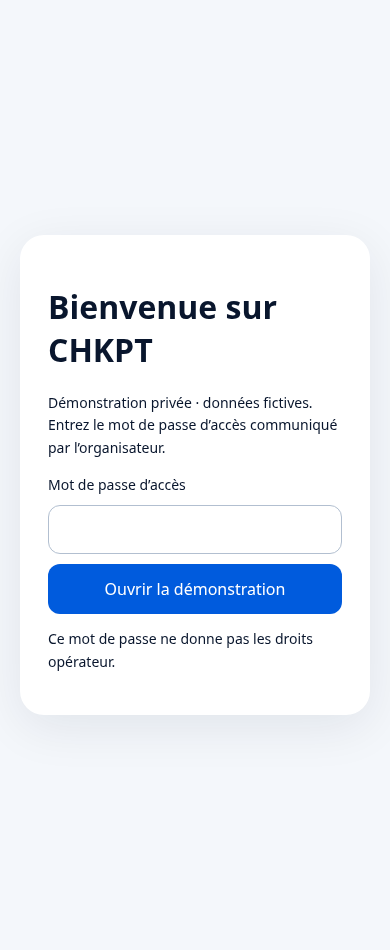

# Ouvrir CHKPT à distance avec un accès privé

## Ce qui est préparé

Le dépôt contient un fichier `render.yaml` pour héberger le serveur existant sur Render. Le téléphone et l’ordinateur d’Ingrid pourront utiliser une adresse HTTPS sans dépendre du Mac, **après création du service et validation du déploiement**.

Aucun compte Render, service, abonnement ou lien public actif n’a été créé depuis cet environnement. La configuration est prête à examiner ; elle ne vaut pas déploiement réussi.

## Deux accès distincts

| Accès | Usage |
|---|---|
| Mot de passe d’accès privé | Ouvrir le site, ses images et ses API. À partager uniquement avec les personnes invitées. |
| Compte opérateur `redloop_admin` et son mot de passe | Démarrer ou réinitialiser la démonstration et accéder aux outils opérateur. À réserver à la présentation. |

Les deux mots de passe doivent être **différents**, comporter au moins 16 caractères et être saisis uniquement dans l’interface sécurisée de l’hébergeur. Ne les envoyez pas dans la conversation ni sur GitHub.

## Étapes sur Render

1. Créer un compte sur [Render](https://dashboard.render.com/) et connecter GitHub.
2. Autoriser uniquement le dépôt privé `youattarae/chkpt-by-red-loop`.
3. Créer un **Blueprint** depuis ce dépôt, branche **`feat/profil-social`**, fichier **`render.yaml`** à la racine.
4. Vérifier le service `chkpt-demo-privee`, avec le runtime Node.js 22. La configuration propose une offre gratuite ; vérifier les conditions et toute indication de prix dans Render avant validation. Aucun paiement n’est autorisé par ce document.
5. Renseigner les variables secrètes demandées :
   - `CHKPT_ACCESS_PASSWORD` : nouveau mot de passe pour ouvrir le site.
   - `CHKPT_DEMO_ADMIN_PASSWORD` : mot de passe opérateur distinct.
6. Laisser les autres variables préparées : `NODE_ENV=production`, `HOST=0.0.0.0`, `PORT=10000`, `CHKPT_PRIVATE_DEMO=true`, `CHKPT_REMOTE_ACCESS=true`.
7. Lancer le déploiement. À la fin, copier l’adresse **HTTPS** affichée par Render.
8. Ouvrir cette adresse dans une fenêtre privée : la page d’accès doit apparaître avant tout contenu CHKPT.
9. Saisir le mot de passe d’accès. Dans Profil → Gérer mon compte, connecter l’opérateur puis démarrer la démo.
10. Tester sur le téléphone **en données mobiles, Wi-Fi désactivé**, et sur le Windows d’Ingrid. Le Mac peut être éteint pour ce test : c’est Render qui sert l’application.

### Si le formulaire demande une configuration manuelle

Créer un Web Service depuis la même branche, avec le dossier racine `CHKPT_CODEX_GITHUB_PRET_A_IMPORTER`, le runtime Node.js 22, la commande de construction `npm ci --include=dev && npm run build` et la commande de démarrage `node --import tsx scripts/present.mjs`. Saisir les mêmes variables. Ne pas utiliser un hébergement de fichiers statiques : les sessions et les checks nécessitent le serveur Node.

## Vérifier la confidentialité

- Sans mot de passe : pas d’accès aux API, images ou fichiers de l’application.
- Avec le mot de passe visiteur : aucun droit opérateur automatique.
- Dans Réglages : **Fermer l’accès privé à distance** ferme l’accès de ce navigateur.
- Une nouvelle fenêtre privée redemande le mot de passe.
- L’historique d’un utilisateur reste réservé à son compte.
- Une fiche partagée reste derrière la protection du site.

Le cookie d’accès est sécurisé, non accessible au JavaScript et expire au bout de huit heures. Les sessions d’accès sont invalidées au redémarrage du serveur. Les tentatives de mot de passe sont limitées. Le serveur refuse de démarrer si la protection distante est activée sans configuration complète.

## Gratuit et répétition devant le jury

Une offre gratuite peut se mettre en veille et demander un délai au premier accès. Son stockage local peut être perdu lors d’un redémarrage ou d’un redéploiement : comptes ajoutés, avis et visites serveur peuvent alors repartir du jeu fictif initial. Les médias importés ne survivent déjà pas au redémarrage.

Pour une présentation importante, ouvrir et répéter la démo en avance. Une offre avec instance active et stockage persistant pourra être étudiée avec son prix ; elle n’est pas configurée ni souscrite ici. Garder le support de secours et la copie locale.

Les publications, intentions et résumé des visites restent propres au navigateur ; les badges sont désormais calculés côté serveur. Se connecter sur le Windows d’Ingrid ne copie pas automatiquement les publications préparées sur le Mac. Les relations de suivi et les avis, eux, sont enregistrés dans la base du serveur, sous réserve de la persistance de cet hébergement.

## Limites de la protection

Cette barrière convient à une démo privée sur une instance derrière le proxy HTTPS de Render ; ce n’est pas une infrastructure de production. Elle utilise un mot de passe partagé, sans invitations nominatives ni gestion avancée des accès. Ne pas l’exposer directement sur un port HTTP en contournant le proxy, ni modifier la confiance du proxy sans revoir cette protection.

La recherche externe Gemini reste facultative. Utiliser le Simulateur pour le scénario fictif ; le GPS réel sous HTTPS ne valide pas une présence dans un lieu fictif si la position est ailleurs.
