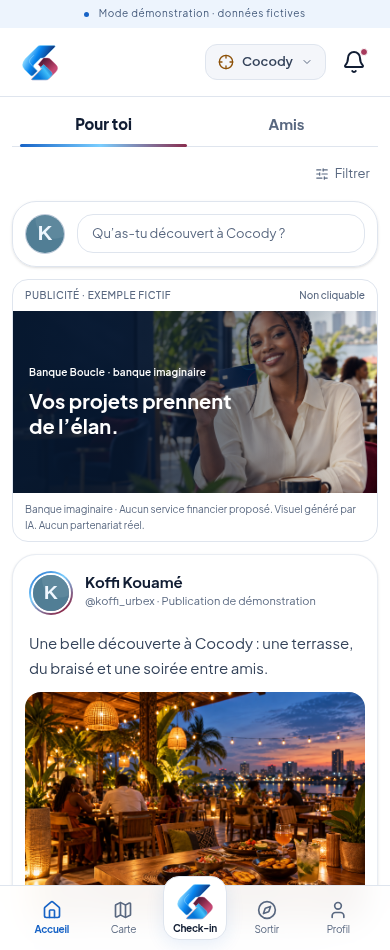
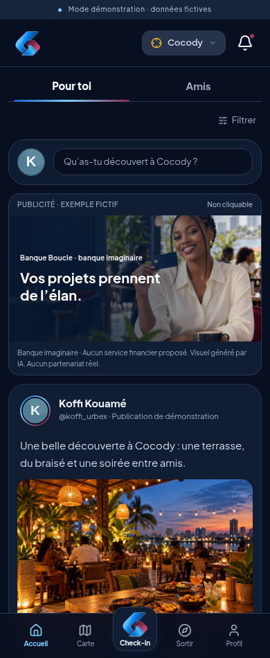
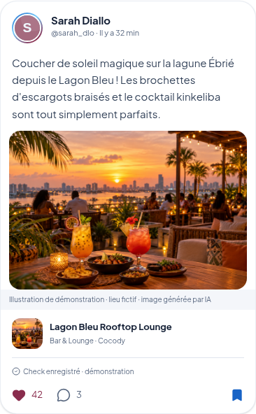
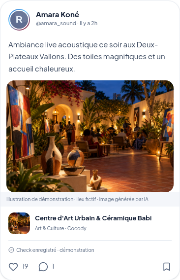
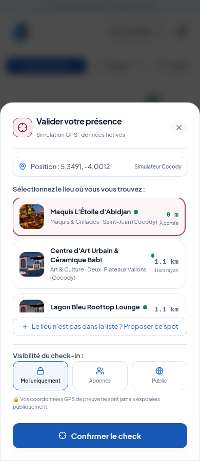

# Accueil CHKPT — deux onglets et publications illustrées

L'accueil reprend la présentation des cartes de la référence fournie, avec deux onglets : **Pour toi** et **Amis**. Les cartes partagent leur composant avec le profil : avatar rond, auteur, texte avant le média, lieu lié, réactions, commentaires et enregistrement du lieu. Les filtres de catégories restent accessibles avec **Filtrer**. La publicité de démonstration conserve ses mentions et reste non cliquable.

La référence corrigée privilégie une image arrondie, puis une ligne de lieu avec vignette. Le check-in commence uniquement par le bouton central : sélectionner le lieu, confirmer le check, puis choisir de publier. Aucun bouton Check n’est présent dans les publications, sur la carte ou dans les fiches. L’en-tête conserve le symbole, le GPS avec la commune sélectionnée et les notifications. Les lettres CHKPT, le sélecteur de commune séparé, le thème et l’avatar de compte sont retirés de cette barre.

**Profil → Réglages** donne accès au mode sombre, à la commune et au choix de position. **Profil → Gérer mon compte** conserve la connexion et les outils de démo. Le total XP ouvre toujours l'historique et le journal des points.

Le bouton de la fenêtre de check-in porte désormais exactement **Confirmer le check**, dans les deux modes GPS. La mention **Simulation GPS · données fictives** reste visible en présentation et le résultat d'une visite simulée reste identifié comme tel. Le libellé ne change pas le choix du lieu, les permissions, le calcul de distance, les points ni le refus des doublons.

## Captures réelles

### Accueil clair

### Accueil sombre

### Nouvelles publications illustrées

### Bouton central → choix du lieu → Confirmer le check

## Visuels et conservation des données

Les illustrations de maquis, terrasse et cour culturelle sont générées par IA et intégrées au projet. Elles représentent des lieux fictifs ; aucun établissement ni personne réelle n'est certifié. Leurs légendes sont visibles sur les cartes. Aucun service d'images externe n'est nécessaire pendant la démonstration.

Les anciens chemins SVG des seules publications fictives sont adaptés à l'affichage pour qu'un navigateur déjà utilisé profite des nouveaux visuels. Les textes, réactions et commentaires sont conservés, ainsi que les URL des médias importés et les permissions d'accès. Un secours graphique local reste disponible.

## Vérification

La recette contrôle les deux onglets et la navigation clavier, le filtre Amis, les catégories, la création d'une publication sans XP de visite, la réaction retrouvée dans le profil et les nouveaux visuels sur un ancien cache de démonstration. Les images sont chargées avec les requêtes externes bloquées. La confirmation reste désactivée tant qu’aucun lieu n’a été choisi. Son libellé et la mention de simulation sont conservés ; les tests existants de GPS, de sécurité, de répétition et de stabilité en mode développement restent exécutés.

Les essais sont effectués avec Chromium sous Linux, sur téléphone et ordinateur et dans les deux thèmes. Une répétition sur Mac et sur le Windows d'Ingrid reste nécessaire après installation. Le prototype reste privé et ses publications restent locales au navigateur.

## Publicité bancaire de démonstration

L’accueil présente **Banque Boucle**, banque imaginaire, dans l’emplacement publicitaire existant. Le visuel est généré par IA et conservé dans le projet, sans chargement externe. L’encart indique Publicité, Exemple fictif, Non cliquable et Aucun partenariat réel. Il ne contient ni lien ni bouton et ne propose aucun service financier.

