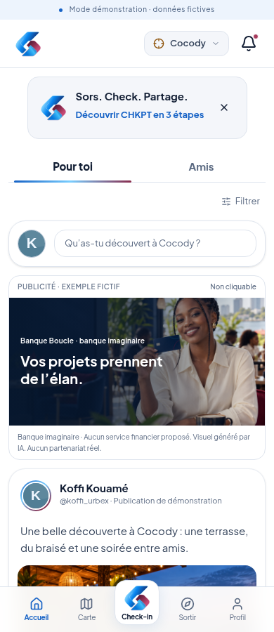
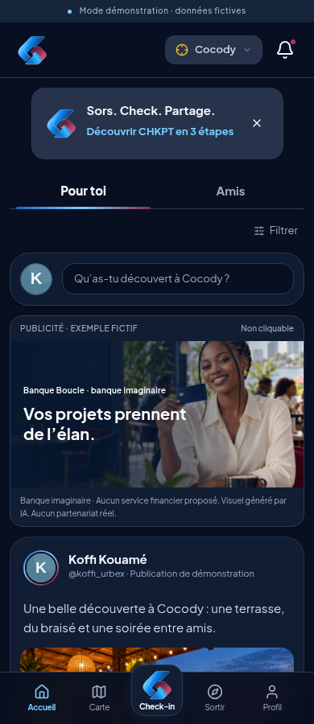
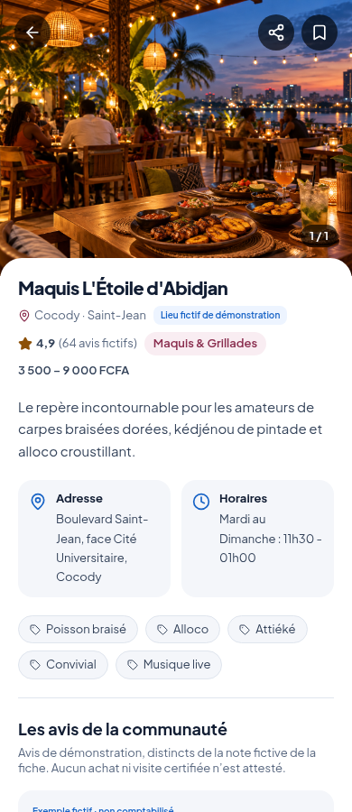
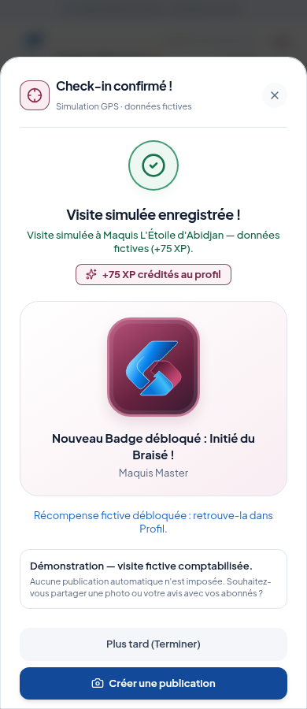

# CHKPT — direction visuelle du 27 octobre 2026

Les réponses du porteur dans `visuels chkpt.docx`, la planche du symbole jointe à la conversation et les échanges suivants actualisent les références historiques. Le porteur a apprécié la proposition puis demandé le symbole comme bouton central de check-in et autorisé la poursuite.

## Choix appliqués

- Interface blanche au premier lancement, indépendamment du thème système. Mode sombre facultatif depuis Profil → Réglages, conservé localement sous `chkpt_theme`.
- Fonds et textes séparés par des couleurs sémantiques partagées entre tous les écrans. Bleu pour les actions principales et la navigation active ; bordeaux pour les réactions et récompenses.
- Symbole CHKPT seul pour la marque en en-tête, avec le GPS affichant la commune sélectionnée et la cloche de notifications. Suppression du bloc promotionnel de l'accueil et du slogan dans l'interface ; fil social et découvertes au premier plan.
- Symbole CHKPT dans l'en-tête, le bouton central avec libellé Check-in et le favicon. Le bouton central garde son action et son nom accessible existants.
- Arrondis conservés, animations sobres et préférence de réduction des mouvements respectée. Police Plus Jakarta Sans conservée, le fichier de la typographie RED LOOP n'ayant pas été fourni.
- Médaillon bordeaux pour la récompense, avec nom du badge et famille issus de l'état réel de la démonstration.
- Image de terrasse générée pour le lieu fictif du scénario, intégrée localement et explicitement signalée. Ajout d'une publication de départ fictive de Koffi, sans preuve de visite et sans XP ; les publications Sarah et Amara restent conservées.

## Fichiers et limites visuelles

`public/brand/chkpt-symbol.svg` est une **adaptation vectorielle simplifiée** de la référence visuelle soumise, pas le fichier maître original ni une reproduction certifiée identique. Il est centralisé pour pouvoir être remplacé par l'asset original. Aucun droit sur une marque tierce ni un nouveau logo officiel n'est revendiqué.

`public/illustrations/maquis-demo.png` est une illustration photoréaliste générée par IA. Elle ne montre pas le véritable établissement nommé dans le scénario. Les autres illustrations SVG originales et leur secours local restent disponibles. Le prototype ne dépend d'aucun service d'images externe pour sa présentation.

Les anciens contenus conservés dans un navigateur ne sont pas effacés par cette mise à jour : la nouvelle publication de départ apparaît sur un navigateur neuf ou après **Démarrer la démo**, action réservée à l'opérateur et qui remet à zéro les données fictives. Le thème choisi est conservé pendant cette remise à zéro.

## Vérification

La recette existante vérifie les accès opérateur, la simulation autorisée uniquement côté serveur, le bon lieu, les XP uniques, le badge, la publication facultative, le profil, l'événement et la répétition.

La recette visuelle supplémentaire vérifie à 320, 390 et 1280 pixels : thème clair par défaut même avec un système sombre, choix conservé après rechargement, retour au clair, symbole dans le bouton central, en-tête accessible, absence de débordement dans les cinq onglets, ouverture du check-in et images locales sans accès externe. Les couleurs des textes principaux, secondaires et des boutons sont contrôlées au seuil 4,5:1 ; ce contrôle ciblé n'est pas un audit complet d'accessibilité.

Les navigateurs sont testés avec Chromium automatisé sous Linux. Cela ne remplace pas la répétition sur le Mac de l'utilisateur et le Windows d'Ingrid. Prototype privé, sans mise en production.

## Voir le résultat

Les captures ci-dessous montrent l'application exécutée, pas la maquette générée initialement.

### Accueil clair et sombre

### Fiche lieu et récompense

