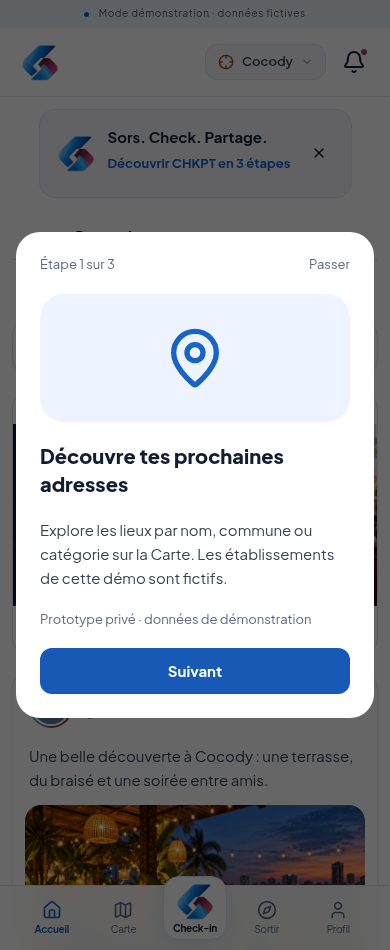
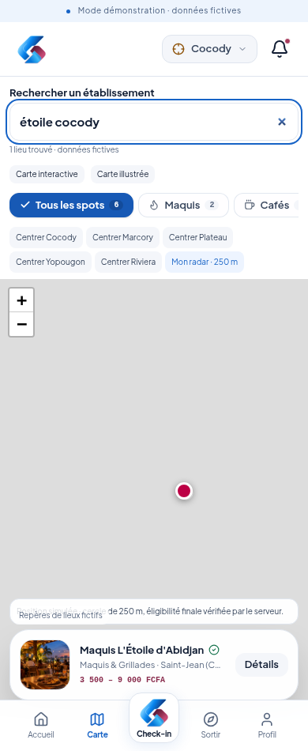
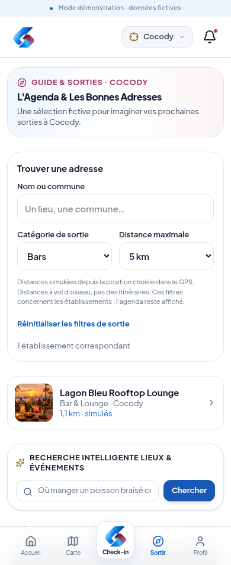
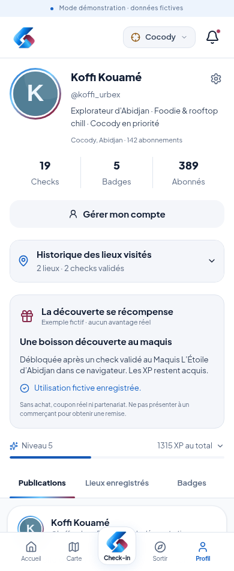
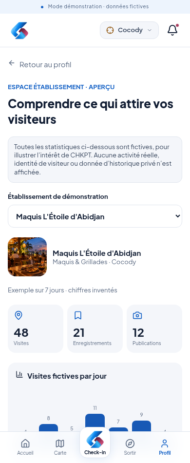
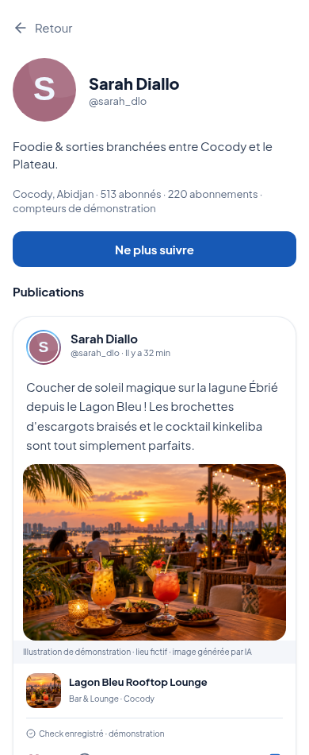
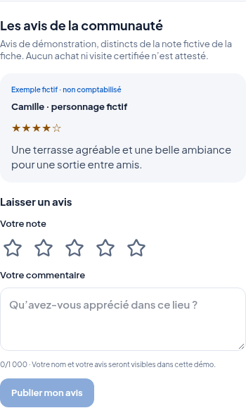
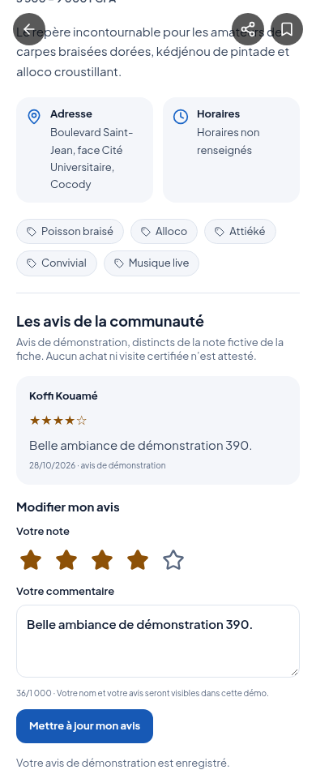

> Mise à jour du 30 octobre : les filtres et la recherche intelligente sont déplacés sur Carte ; Accueil reçoit une recherche générale, Sortir reste éditorial. Voir [la décision actualisée](RECHERCHE_SORTIR_ET_CLASSEMENT.md). Les descriptions antérieures ci-dessous sont historiques sur ces points.

# Compléments de démonstration — 28 octobre 2026

## Bienvenue

Un encart propose **Découvrir CHKPT en 3 étapes** : découvrir, checker, partager. Il peut être ignoré et son choix est mémorisé. Profil → Réglages → Revoir les 3 étapes permet de le rejouer. Aucun check n’est lancé automatiquement.

## Rechercher et filtrer

La Carte conserve ses catégories et ajoute une recherche par nom, commune ou catégorie, insensible aux accents et à la casse.

Sortir propose une recherche locale avec **Bars, Restaurants, Clubs, Maquis, Cafés et Culture**, et un rayon de **1, 5, 10 ou 20 km**. Les critères se combinent et se réinitialisent. Les distances sont à vol d’oiseau depuis la position sélectionnée : simulées en mode Simulateur, estimées en GPS réel. En attente du GPS réel, aucun rayon ne se base sur une position simulée de secours. Ces filtres concernent les établissements ; l’agenda reste séparé.

Le jeu actuel ne comporte pas de club identifié : le filtre Clubs affiche honnêtement un état vide. Aucun bar n’est rebaptisé club pour remplir le résultat.

## Récompense concrète, fictive

Dans Profil, une boisson découverte fictive se débloque après un check validé au maquis du scénario avec ce compte. Le bouton permet d’essayer l’utilisation fictive ; cet état est mémorisé et les XP ne sont pas dépensés. Le personnage ne bénéficie d’aucune offre réelle et aucun coupon commercial n’est émis.

## Aperçu établissement

Profil → Réglages → **Aperçu établissement · fictif** montre deux établissements et des exemples de visites, enregistrements, publications et fréquentation sur sept jours. Toutes les données sont inventées et explicitement signalées. Aucun historique privé, nom de visiteur ni statistique réelle n’est utilisé.

## Profils et suivi

Toucher l’avatar ou le nom d’un auteur ouvre son profil. Un compte connecté peut suivre un profil public, ne plus le suivre et retrouver ses publications accessibles dans **Amis**. La relation est enregistrée côté serveur, sans doublon. Le compteur préchargé reste un compteur fictif de démonstration, ajusté par ces actions.

Les profils privés et mineurs ne donnent pas accès à leurs publications ; les demandes de suivi privé ne sont pas simulées comme acceptées. Aucun historique personnel ne figure sur un profil consulté. Les publications et médias sont désormais conservés sur le serveur et partagés entre les appareils du compte selon leur audience. Voir [synchronisation et sauvegarde](SYNCHRONISATION_ET_SAUVEGARDE.md).

## Avis sur les lieux

`ReviewSection` est intégré dans la fiche lieu. Un utilisateur connecté avec profil public peut donner **1 à 5 étoiles**, écrire un commentaire de **3 à 1 000 caractères** et modifier son avis. Un seul avis par compte et par lieu est enregistré dans la base serveur. La note, le texte et l’auteur sont validés côté serveur.

Un exemple de Camille, personnage fictif, est affiché lorsqu’aucun avis n’est enregistré. Il est marqué **Exemple fictif · non comptabilisé**. Les nouveaux avis sont distincts de la note et du nombre d’avis fictifs préchargés sur la fiche ; ils ne constituent pas une preuve d’achat ou de présence. Les profils privés et mineurs ne publient pas d’avis publics dans cette démo.

## Accès privé à distance

Voir [ACCES_PRIVE_DISTANCE.md](ACCES_PRIVE_DISTANCE.md) : configuration Render/Node.js, écran d’accès, deux mots de passe distincts et vérifications avant présentation. L’hébergement est préparé mais sa création et son test sur Internet nécessitent le compte du porteur. Aucun service payant n’est créé automatiquement.
