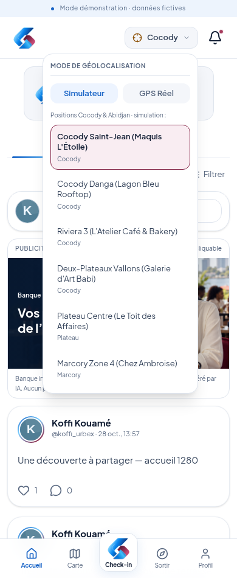
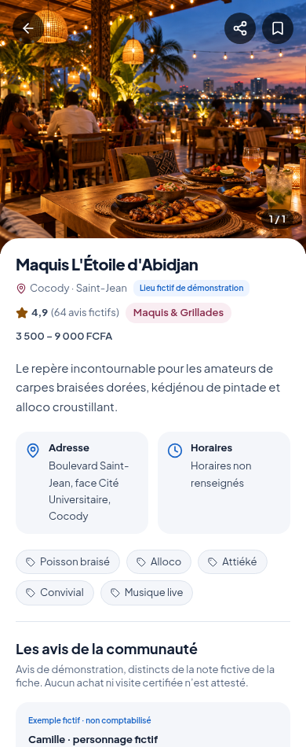
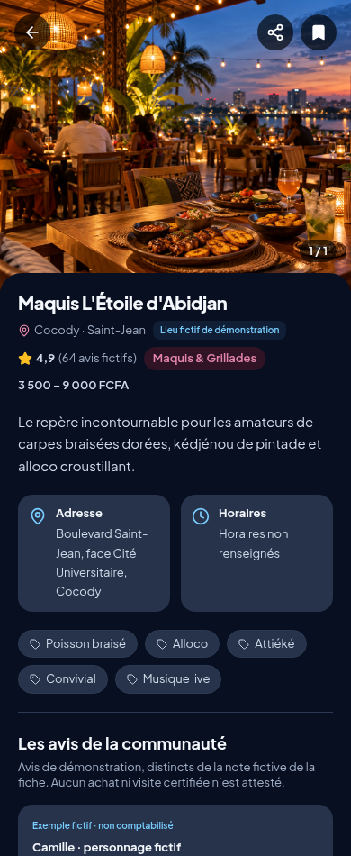
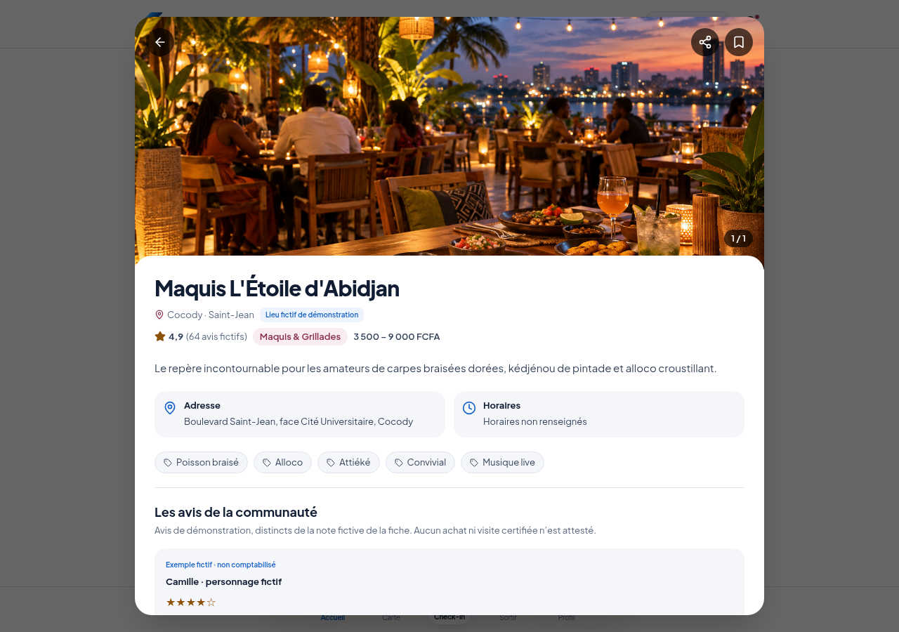

# GPS avec commune et fiche lieu grand format

Le bouton de l'en-tête associe le symbole GPS à la commune choisie, par exemple **Cocody**. Il ouvre le menu **Mode de géolocalisation**, avec **Simulateur** et **GPS Réel**. En simulation, les six positions du prototype sont présentées sous forme de liste : Saint-Jean, Danga, Riviera 3, Deux-Plateaux, Plateau et Marcory. Le choix met à jour la position simulée et la commune du bouton, puis referme le menu.

Le mode sombre reste dans **Profil → Réglages**. La commune n'a pas de sélecteur supplémentaire dans l'en-tête et les lettres CHKPT restent retirées.

## Fiche lieu

La fiche remplit l'écran sur téléphone et utilise une grande fenêtre sur ordinateur. La photo occupe le haut de l'écran ; le nom, la commune, les avis fictifs, les prix, la description, l'adresse, les horaires et les tags apparaissent dessous. Les horaires ne sont plus tronqués. Le bouton de retour et les favoris restent accessibles pendant le défilement.

La galerie utilise les images disponibles et dédupliquées, avec changement de visuel lorsqu'il y en a plusieurs. Aucun nombre de photos ou contenu manquant n'est inventé. Les notes, avis et visites du prototype restent explicitement fictifs.

Le parcours de check-in reste **bouton central → choix du lieu → Confirmer le check → publication facultative**. Aucun raccourci de check n'est réintroduit dans la fiche.

### Téléphone — clair

### Téléphone — sombre

### Ordinateur

## Contrôles

La recette vérifie à 320 × 568, 390 × 950 et 1280 × 900 pixels : sélection d'une position et commune du bouton, deux modes GPS, grand format mobile / ordinateur, absence de débordement horizontal, favoris, retour après défilement et fermeture avec Échap. La galerie est testée sur une fiche disposant de plusieurs visuels. Les deux thèmes et le parcours complet de démonstration restent couverts, sans modifier les contrôles du serveur.

Vérifications avec Chromium Linux ; répétition sur les appareils de présentation à refaire après installation. Le prototype reste privé et les lieux, chiffres et images sont des données de démonstration.
