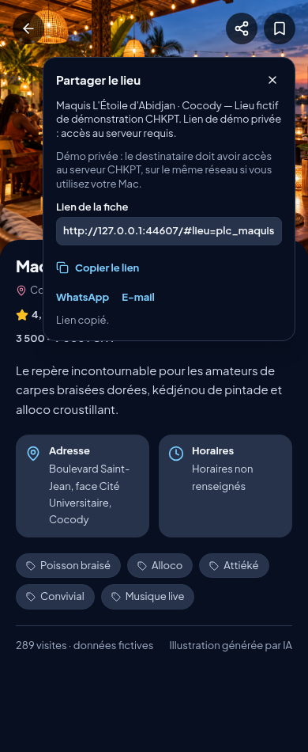
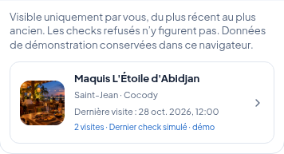

# Partager un établissement et retrouver ses visites

## Partager

Ouvrir une fiche lieu, puis toucher le symbole de partage en haut à droite, à côté des favoris.

- Sur un appareil compatible, le menu de partage du téléphone permet de choisir l’application destinataire.
- Sinon, un volet propose le lien à copier, WhatsApp et l’e-mail. Sans accès au presse-papiers, le lien peut être sélectionné et copié manuellement.
- Le lien ouvre directement la fiche correspondante. Aucun check-in ou publication n’est déclenché.
- Seuls le nom, la commune, la mention de lieu fictif et le lien de la fiche sont transmis. Aucun jeton de session, historique, identité du visiteur ou coordonnées GPS ne sont inclus.

**La démo reste privée.** Un lien vers le Mac n’est accessible que si le serveur tourne et si le destinataire peut joindre son réseau. Le partage ne rend pas l’application accessible sur Internet.

## Historique du profil

Dans Profil, ouvrir **Historique des lieux visités**, sous Gérer mon compte.

L’historique appartient uniquement au propriétaire du profil. Le serveur refuse également la consultation de l’historique d’un autre compte, même si son profil ou ses checks sont publics et même si le demandeur est opérateur. Les publications volontairement partagées ne donnent pas accès à cet historique.

Chaque lieu apparaît une fois, du dernier visité au plus ancien, avec le nombre de visites, la dernière date et la mention simulée le cas échéant. Toucher le lieu ouvre sa fiche. Les tentatives refusées restent dans le volet d’activité technique existant, pas dans la liste des lieux visités.

Cette liste utilise les checks conservés dans ce navigateur. Elle n’est pas synchronisée entre appareils et n’invente pas de visites à partir du compteur fictif du profil.

## Vérifications

Tests du partage natif, de son annulation, de la copie et de son secours manuel ; lien direct et identifiant inconnu ; absence de session dans le lien ; regroupement, ordre, exclusions des refus et d’un autre utilisateur ; deux thèmes et largeurs 320/390/1280 pixels. Contrôles serveur des refus anonymes et tiers, y compris pour les profils publics et les opérateurs. Essais réels Safari iPhone et Windows à compléter lors de la répétition.
