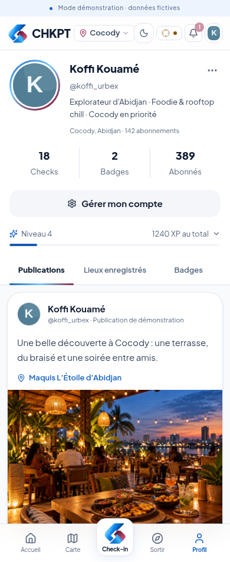
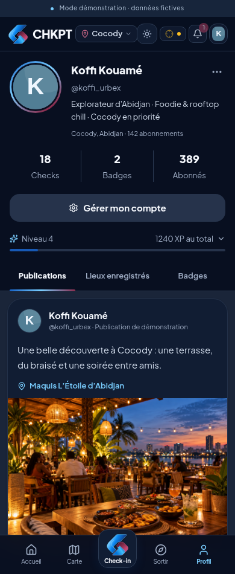
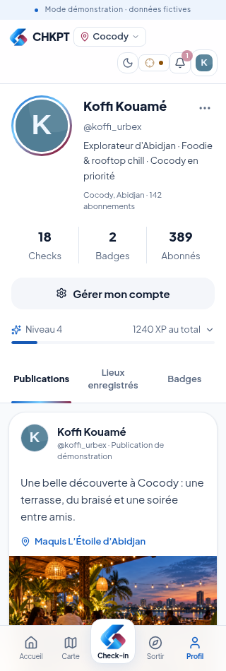
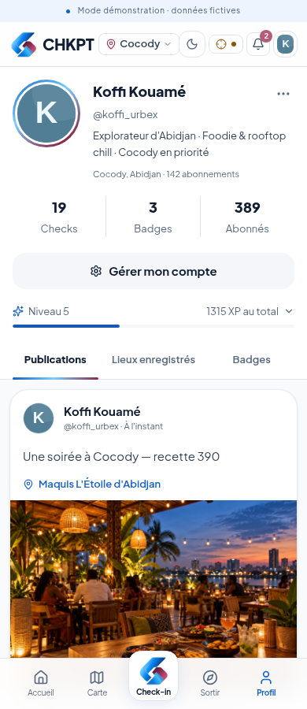

# Profil CHKPT — disposition inspirée de la référence fournie

La disposition du profil est revue à la demande du porteur : avatar rond, nom et identifiant à côté, bio, trois compteurs alignés, bouton de gestion du compte et trois onglets. Le contenu reste celui du prototype fictif existant, avec Koffi ; les chiffres et la photographie de la référence ne sont pas importés.

## Organisation

- **Présentation** : avatar entouré des couleurs CHKPT, nom, identifiant, bio, zone et abonnements. Un profil privé conserve une indication visible.
- **Compteurs** : Checks (compteur du profil), Badges (trophées actuellement débloqués) et Abonnés. Aucun chiffre n'est augmenté pour correspondre à la référence.
- **Gérer mon compte** : accès à la fenêtre de compte existante, avec connexion et outils de démo autorisés. L'édition des informations du profil ne fait pas partie de ce changement.
- **Progression** : niveau et total XP restent visibles dans une ligne compacte. Le bouton à trois points ou la ligne XP ouvre le volet **Mon activité**, avec les visites et le journal des points.
- **Publications** : onglet sélectionné à l'ouverture, avec auteur, texte, lieu et média. Les mentions de simulation, de confidentialité et d'illustration fictive restent conservées. Réactions et commentaires utilisent les mêmes données que le fil d'accueil.
- **Lieux enregistrés** : lieux réellement enregistrés dans ce navigateur ; les cartes ouvrent leur fiche. Le signet d'une publication enregistre son lieu lié et porte un libellé explicite.
- **Badges** : collection existante intégrée dans le profil, avec accès conservé à sa vue complète. Les onglets sont utilisables au clavier avec les flèches, Début et Fin.

La navigation générale reste Accueil, Carte, symbole CHKPT pour le check-in, Sortir et Profil. Les styles clair et sombre utilisent les couleurs communes du prototype. Les autorisations serveur, le calcul des XP et les données existantes ne changent pas.

## Voir le profil exécuté

### Téléphone — clair

### Téléphone — sombre

### Petit écran

### Après le check-in et la publication du scénario

## Vérification et limites

La recette du profil utilise Chromium à 320, 390 et 1280 pixels, en clair et en sombre, sans service d'images externe. Elle vérifie les onglets, leur navigation clavier, les réactions, les commentaires, l'enregistrement d'un lieu et leur conservation après rechargement, l'accès au compte, les badges et le volet d'activité. À 320 pixels, une vraie requête de check-in simulé vérifie aussi la lisibilité d'un historique rempli et du journal XP.

La recette complète conserve les contrôles de sécurité et le scénario réinitialisable, ainsi que la stabilité en mode développement et le lancement de présentation. Ces tests sous Linux ne remplacent pas une répétition sur Mac et sur le Windows d'Ingrid. Les publications et interactions restent locales au navigateur ; le prototype reste privé, avec données fictives.
