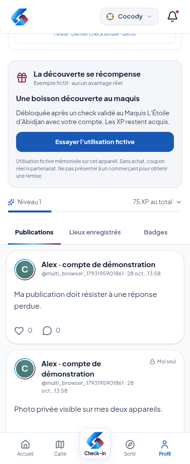
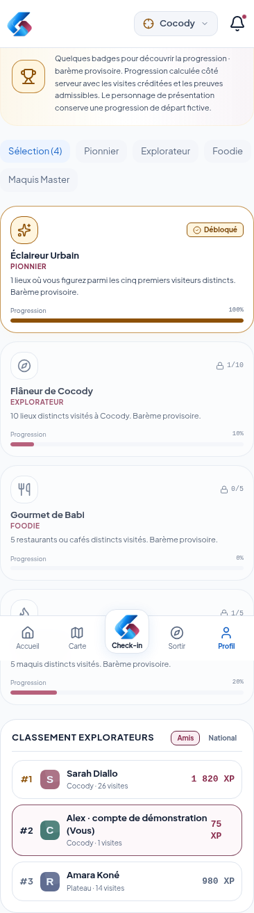
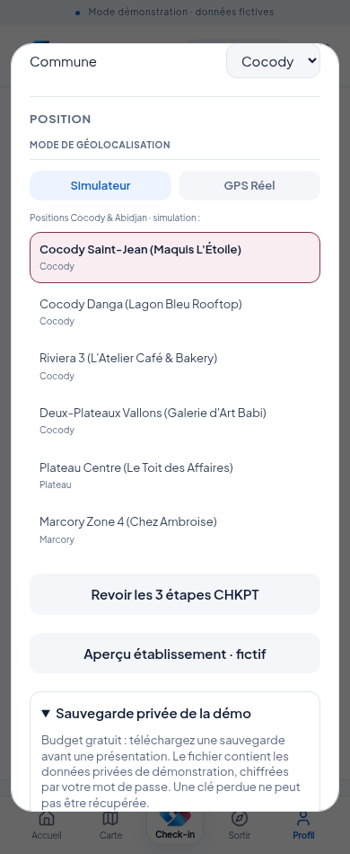

# Retrouver sa démonstration sur deux appareils

## Ce qui change

Avec le même compte et le même serveur CHKPT, le téléphone et l’ordinateur retrouvent désormais les données suivantes :

| Donnée | Fonctionnement actuel |
|---|---|
| Compte et profil existant | Enregistrés sur le serveur |
| Publications, photos importées | Enregistrées sur le serveur, selon leur audience |
| Réactions et commentaires | Enregistrés sur le serveur |
| Lieux enregistrés | Propres au compte, partagés entre ses appareils |
| Visites et historique | Serveur, consultables uniquement par le propriétaire |
| XP et progression des badges | Calculés côté serveur |
| Relations Suivre / Ne plus suivre | Enregistrées sur le serveur |
| Mode sombre | Préférence de cet appareil |
| Intentions d’événement et utilisation de récompense fictive | Encore locales au navigateur |
| Notifications déjà affichées | Encore locales au navigateur |

Les pages se rafraîchissent régulièrement lorsqu’elles sont visibles, ainsi qu’au retour sur la fenêtre. Ce n’est pas une messagerie instantanée : prévoir quelques secondes pour voir une action de l’autre appareil.

Les publications restent facultatives. Le texte d’une publication non confirmée reste dans son formulaire ; réessayer la même publication après une réponse réseau perdue ne doit pas créer un doublon. Aucune réussite n’est annoncée avant confirmation serveur.

## Essai simple

1. Ouvrir le même serveur depuis le Mac et le téléphone, sur le même réseau si le serveur tourne sur le Mac.
2. Pour un compte de test créé via Inscription, se connecter avec le même identifiant et le même mot de passe sur les deux appareils. Pour le personnage Koffi, connecter l’opérateur puis le choisir dans Profils Démo (opérateur), sans réinitialiser les données.
3. Sur le Mac, publier un texte. Sur le téléphone, ouvrir Profil → Publications : le retrouver après quelques secondes.
4. Enregistrer un établissement sur l’un ; vérifier Lieux enregistrés sur l’autre.
5. Effectuer un check admissible ; vérifier les XP et l’historique du même compte sur l’autre appareil.
6. Essayer un second compte distinct : il ne doit pas accéder aux publications privées ni à l’historique du premier.

Les photos privées sont chargées avec une requête authentifiée. Le jeton de session n’est pas ajouté à leur lien. Les anciennes permissions par jeton dans l’URL ne donnent plus accès à une photo privée.

Pour quitter un appareil partagé : Profil → Gérer mon compte → **Se déconnecter de cet appareil**. La fermeture de l’accès privé distant ferme également la session de compte sur cet appareil. Les autres appareils restent connectés. En cas de réseau coupé, l’accès local est retiré ; la révocation serveur ne peut être garantie avant son retour.

## Conservation des données

Les données et médias sont conservés dans la base du serveur, sous `.data/` par défaut. Le chemin peut être configuré avec `CHKPT_DATA_DIR` si un hébergeur fournit réellement un stockage conservé. Un redémarrage du processus ne supprime plus les photos importées tant que ce dossier est conservé.

**Cette configuration ne crée pas un disque persistant chez l’hébergeur.** Sur l’offre gratuite Render préparée, le système de fichiers peut être effacé lors d’un redémarrage ou d’un redéploiement. Une sauvegarde téléchargée permet de reprendre le dernier état sauvegardé, pas les actions effectuées après elle.

Le budget retenu est **strictement gratuit**. Aucun service payant, disque payant ou abonnement n’a été souscrit. La conservation permanente gratuite sur Internet n’est pas revendiquée ; l’hébergement réel reste à créer et à vérifier.

Pour cette démonstration, les médias sont enregistrés dans la base JSON existante avec un plafond cumulé de 50 Mo. Ce choix limite les changements ; ce n’est pas un stockage de production pour de nombreuses photos.

## Sauvegarder avant une présentation

Avec le compte opérateur administrateur :

1. Aller dans Profil → Réglages → **Sauvegarde privée de la démo**.
2. Choisir un mot de passe de sauvegarde de 16 caractères minimum.
3. Toucher **Télécharger une sauvegarde chiffrée**.
4. Conserver le fichier `.chkpt` et son mot de passe séparément. Ne transmettre aucun des deux dans cette conversation ou sur GitHub.

La sauvegarde contient les comptes, leurs données de connexion protégées, les publications, photos, favoris, visites, avis, relations et progressions. Elle est chiffrée ; son mot de passe n’est pas conservé par CHKPT. **Sans lui, elle ne peut pas être restaurée.** Les sessions actives ne sont pas incluses.

## Restaurer un jeu de démonstration

À faire avant la répétition, en prévenant les autres personnes connectées :

1. Se connecter comme administrateur sur le serveur à restaurer.
2. Ouvrir le même panneau de sauvegarde.
3. Sélectionner le fichier `.chkpt` et saisir son mot de passe.
4. Saisir **REMPLACER LA DÉMO**, puis toucher Restaurer.
5. Se reconnecter ensuite : les anciennes sessions sont fermées.

**Restaurer remplace toutes les données de la démo.** Une copie chiffrée de sécurité de l’état précédent est enregistrée avant remplacement ; jusqu’à trois copies sont conservées dans le dossier de données du serveur. Elles peuvent elles aussi disparaître avec un disque gratuit éphémère : elles ne remplacent pas un téléchargement de sauvegarde.

Un mot de passe erroné ou un fichier invalide ne doit pas remplacer les données courantes. Seuls les administrateurs/superadministrateurs de la démo privée ont accès à ces opérations ; un compte normal ou un modérateur ne peut pas exporter les historiques privés.

Ne pas utiliser **Démarrer la démo** ou **Réinitialiser** pour retrouver des données : ces commandes remettent le scénario fictif à zéro. Pour revoir des données existantes, se connecter simplement au compte concerné.

## Mettre à jour une ancienne installation

Conserver l’ancien dossier entier avant de changer de version. Arrêter le serveur, puis conserver localement son `.env` et son dossier `.data` lors de la mise à jour. Ne pas les inclure dans un ZIP à partager ou dans GitHub. La base existante est enrichie sans effacer ses comptes et visites.

Les anciennes publications et visites qui n’existaient que dans le navigateur ne sont pas importées silencieusement comme données vérifiées. Une copie locale du cache appartenant au compte peut être exportée depuis Réglages après authentification, via **Exporter mes anciennes données de cet appareil**. Le fichier est privé et non chiffré ; le conserver localement. Il ne s’agit pas d’une fonction d’import automatique.

Les images qui étaient uniquement en mémoire dans l’ancienne version ne peuvent pas être recréées après sa fermeture ; garder les fichiers originaux. Les nouvelles images importées sont désormais conservées côté serveur.

## Badges simplifiés pour le prototype

L’écran présente une petite sélection, au maximum six cartes, dont les premiers badges de découverte et les badges obtenus pertinents. Le catalogue étendu reste dans le code, sans être déroulé dans le prototype. La structure finale « badges distincts et degrés » reste à arbitrer : elle n’a pas été remplacée à partir de simples propositions du document de conception.

## Vérifications

Tests avec deux navigateurs sans cache commun : publication, favoris, XP et historique visibles sur l’autre appareil ; photo privée chargée uniquement avec le bon compte ; réponse réseau perdue puis nouvelle tentative sans doublon ; ancienne réponse de synchronisation ignorée après changement de compte.

Tests serveur de redémarrage avec données et média conservés, de permissions et de sauvegarde/restauration chiffrées, avec révocation des sessions après restauration. Une répétition sur le Mac, Safari et Windows reste nécessaire. Aucun déploiement sur Internet n’est annoncé comme réalisé.

## Captures de vérification

